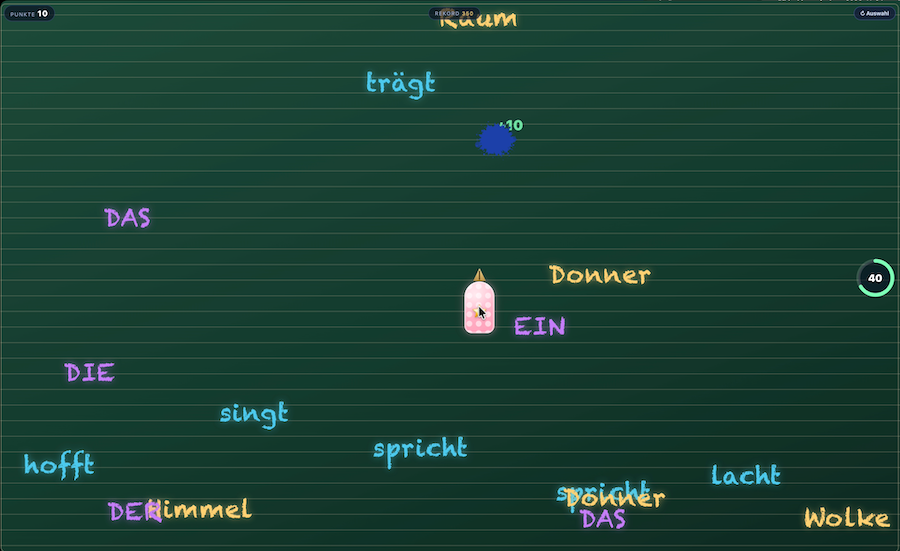

# Wortart-Kleckser

Ein kinderfreundliches Shooter-Spiel: Kleckse mit deinem Füller die herabsinkenden Wörter ab – aber nur mit der richtigen Wortart!

## Spielen

Öffne `index.html` im Browser (oder nutze die GitHub Pages-Version, siehe unten).

- **Steuerung**: Maus oder WASD / Pfeiltasten zum Bewegen
- **Abfeuern**: linke Maustaste oder Leertaste
- **Punkte**: Treffer +10, falsche Wortart −10 (Score-Floor 0)
- **Ziel**: 60 Sekunden überleben – das Zielwort erreicht die untere Kante und das Spiel endet

## Wortarten

Wähle vor dem Start genau eine Zielwortart: **Nomen**, **Artikel** oder **Verb**. Nur Wörter dieser Art bringen Punkte.

## Lizenz

MIT – siehe [LICENSE](LICENSE).

## GitHub Pages

Das Spiel ist über GitHub Pages verfügbar:
<https://nofonbg.github.io/Wortart-Kleckser/>
