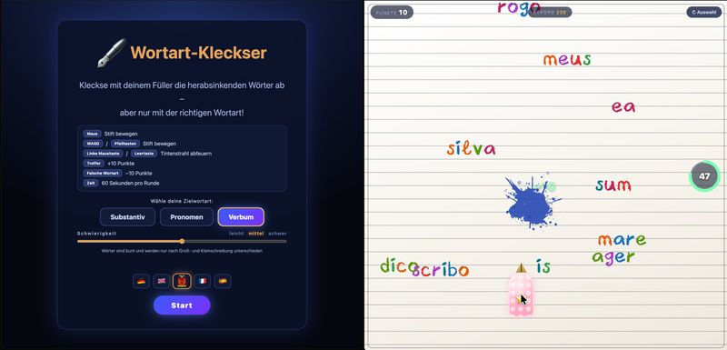
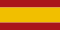
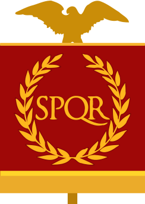

# 🖊️ Wortart-Kleckser

**Kleckse mit deinem Füller die herabsinkenden Wörter weg – aber nur mit der richtigen Wortart!**  
Drei Schwierigkeits-Level (leicht, mittel, schwer) und fünf Sprachen (Deutsch, English, Français, Español, Latein).  
todo: weitere Wortarten, größerer Wortschatz, weitere Sprachen

Öffne `index.html` im Browser (oder nutze die Live-Demo oben).

- **Steuerung**: Maus oder WASD / Pfeiltasten zum Bewegen
- **Abfeuern**: linke Maustaste oder Leertaste
- **Punkte**: Treffer +10, falsche Wortart −10 (Score-Floor 0)
- **Ziel**: 60 Sekunden überleben – das Zielwort erreicht die untere Kante und das Spiel endet

## Schwierigkeits-Level

Vor dem Start wählst du den Schwierigkeitsgrad per Slider. Jedes Level ändert, wie die Wörter aussehen und fallen:

- **leicht** 🟢 – Wörter werden nach Farbe und Groß- und Kleinschreibung unterschieden (langsam fallend)
- **mittel** 🟡 – Wörter sind bunt, aber nur Groß- und Kleinschreibung unterscheidet die Wortart (mittelschnell)
- **schwer** 🔴 – alle Wörter sind bunt und werden klein geschrieben, dazu hohe Fallgeschwindigkeit (kaum mehr Rückschluss auf die Wortart)

## Sprachen & Wortarten

Vor dem Start wählst du per Flaggen-Auswahl eine der fünf Sprachen und anschließend genau eine Zielwortart dieser Sprache:

| Sprache | Flagge | Wortarten |
|---|---|---|
| Deutsch |  | Nomen, Artikel, Verb |
| English |  | Noun, Verb, Pronoun |
| Français |  | Nom, Verbe, Pronom |
| Español |  | Sustantivo, Verbo, Pronombre |
| Latein |  | Substantiv, Pronomen, Verbum (ohne Artikel) |

Nur Wörter der gewählten Wortart bringen Punkte. Nicht verfügbare Sprachen sind ausgegraut (aktuell sind alle fünf verfügbar).

## Starten

Da die Wortliste `words.json` mit `fetch()` relativ geladen wird, muss die Seite über einen Webserver bereitgestellt werden (öffnen per `file://` wird von Browsern blockiert):

Alle Ressourcen liegen lokal, es werden keine externen CDN-Aufrufe gemacht.

## Lizenz
**CC0 CrayonLibre-Regular.woff**: https://ggbot.itch.io/crayon-libre-font   

**CC BY-NC-SA 4.0 – Namensnennung, nicht-kommerziell, gleiche Lizenz**
(vollständiger Text der Lizenz in [`LICENSE`](LICENSE),
Übersicht auf deutsch: <https://creativecommons.org/licenses/by-nc-sa/4.0/de>)

Das eigene Werk darf geteilt, genutzt und bearbeitet werden, sofern gilt:

1. **Namensnennung** – `© 2026 Norbert Forster, CC BY-NC-SA 4.0`
2. **Nicht kommerziell** – keine Verwendung zu kommerziellen Zwecken
3. **Weitergabe unter denselben Bedingungen** – Abwandlungen tragen dieselbe Lizenz
